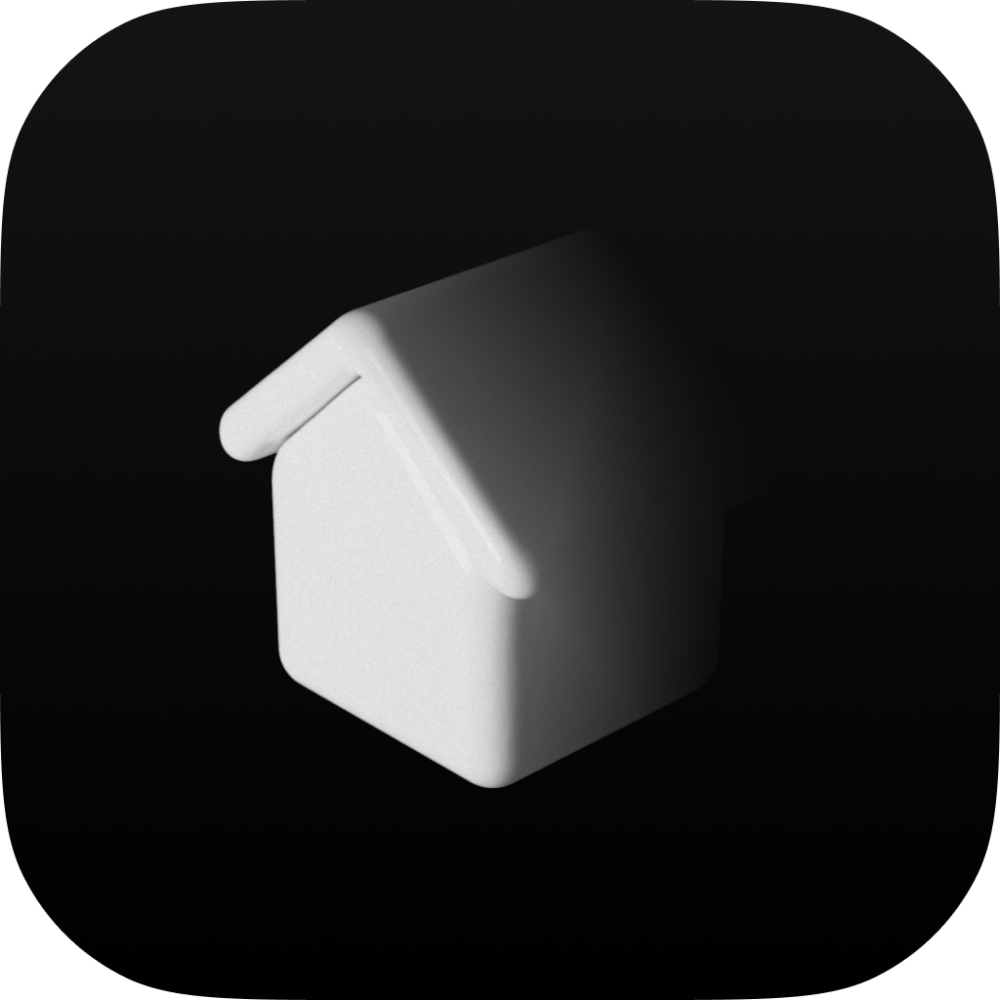

# Haus

[](https://github.com/resonaura/haus/releases/latest)
[](https://github.com/resonaura/haus/actions/workflows/build.yml)
[](#installation)
[](#haus-hub-linux-docker--wsl2)
[](#development)
[](LICENSE)

An autonomous, camera-first smart home platform. Haus combines a standalone local **Haus Hub** server with native-feeling **Desktop** (macOS, Windows, Linux) and **Mobile** (iOS, Android) apps—bringing live cameras, NVR recordings, room controls, scenes, automations, local protocols, and third-party ecosystems together without requiring Home Assistant.

---

## Overview

Haus owns its entire smart home stack locally: identity, rooms, devices, scenes, automations, native protocols (**MQTT**, **Matter**, **Zigbee**, **Thread**, **HomeKit/HKSV**), local NVR recording/AI detection, host telemetry, and isolated plugin/integration compatibility via **Kitsune**.

Home Assistant is supported strictly as an optional external compatibility adapter and migration source (`packages/ha`, `custom_components/haus`)—no core feature requires a running Home Assistant instance.

Authentication and rotating credentials remain in OS-encrypted storage and Hub-owned private vaults; tokens, pairing secrets, and private media URLs never leak into renderer state. The web preview (`pnpm dev:web`) runs against an isolated demo home without touching real devices.

## Highlights

- **Standalone Haus Hub (`apps/hub`)**: single NestJS TypeScript server owning the home domain, TypeORM/SQLite persistence, native MQTT broker (with HA-compatible discovery and 7-day reboot/stale grace retention), Matter/Zigbee/Thread controllers, HomeKit/HKSV bridges, local NVR recording & encrypted backups, and multi-hub telemetry.
- **Kitsune ecosystem compatibility (`packages/kitsune`)**: isolated runtime executing Home Assistant integrations (`ha-flow` headless config/options/entity worker), HACS repositories, Homebridge plugins, Scrypted camera plugins, and managed Docker Apps (`packages/apps`).
- **Camera-first home & local NVR**: live WebRTC/HLS/RTSP playback, smoothly refreshed snapshots, canvas recording timeline with virtualized clip loading, local ONNX/C++ activity detection (`packages/ai`), and native HomeKit Secure Video (`packages/homekit`, `packages/media`).
- **Thoughtful adaptive Liquid Glass UI**: native macOS Liquid Glass / vibrancy, Windows acrylic, and blur-aware Linux surfaces paired with analytical continuous-corner 9-slice rim lighting (`@haus/icons` C++20 worker) that adapts to active device colors and multi-color light effects.
- **Radar-first device discovery & pairing**: unified Add Device flow surfacing discovered LAN/mDNS/protocol devices immediately alongside QR/PIN pairing (Matter, HomeKit, Improv, Wi-Fi), cameras, and integrations.
- **Room-aware device & lighting controls**: optimistic updates with per-entity command serialization, light output color/temperature memory, multi-fixture light grouping, delayed "On Now" departure grace, and room-organized scenes/automations.

## Monorepo Layout

Haus uses a single pnpm + Turborepo ESM workspace across 3 applications and 17 shared packages:

### Applications (`apps/*`)

| App            | Package         | Role                                                                                                                                   |
| -------------- | --------------- | -------------------------------------------------------------------------------------------------------------------------------------- |
| `apps/hub`     | `@haus/hub`     | Standalone NestJS Haus Hub server: home core, native MQTT/radio/HomeKit/Kitsune orchestration, NVR recording/streaming, and telemetry. |
| `apps/desktop` | `@haus/desktop` | Electron + React + HeroUI desktop client for macOS, Windows, and Linux.                                                                |
| `apps/mobile`  | `@haus/mobile`  | Expo / React Native mobile client for iOS and Android.                                                                                 |

### Shared Packages (`packages/*`)

| Package            | Responsibility                                                                                                        |
| ------------------ | --------------------------------------------------------------------------------------------------------------------- |
| `packages/core`    | Platform-neutral domain model, canonical identities, readable addresses (`type::area:device:entity`), commands, auth. |
| `packages/state`   | Selector-based Zustand vanilla store with optimistic overlay and reconciliation.                                      |
| `packages/ui`      | Shared design tokens, categories, formatters, controls, and time-series charts.                                       |
| `packages/icons`   | 1:1 continuous-corner Liquid Glass enclosure/rim & brand icon renderer with persistent C++20 `haus-icon-worker`.      |
| `packages/ipc`     | Direct E2EE binary IPC transport, cryptography, and terminal/Docker stream runtimes.                                  |
| `packages/apps`    | Neutral Apps manifest, deny-by-default permission policy, lifecycle orchestration, and least-privilege Docker driver. |
| `packages/kitsune` | Isolated virtualization runtime for HA integrations (`ha-flow`), HACS, Homebridge, Scrypted, and vendor camera hubs.  |
| `packages/mqtt`    | Native MQTT broker/client, HA-compatible discovery & template parsing, availability, command routing, and retention.  |
| `packages/matter`  | Native Matter controller, commissioning, and full cluster support.                                                    |
| `packages/zigbee`  | Native Zigbee coordinator, ZCL clusters, and permit-join lifecycle.                                                   |
| `packages/thread`  | Native Thread controller, operational datasets, and credential vault.                                                 |
| `packages/homekit` | Apple Home HAP bridges, per-camera accessories, HKSV recording, HAP-BLE, and SRTP live streaming/talkback.            |
| `packages/media`   | FFmpeg/ffprobe runtime, HLS/WebRTC/SRTP/HKSV streaming, recording, snapshots, transcoding, and native C++ pipeline.   |
| `packages/ai`      | Local camera activity detection (C++ native engine + pinned NanoDet ONNX model).                                      |
| `packages/bridge`  | Authenticated native camera bridge discovery and ownership protocol (`_rsnra-camera._tcp`).                           |
| `packages/servers` | Host telemetry, CPU/memory/disk/battery/service probes, and node client communications.                               |
| `packages/ha`      | Optional external Home Assistant REST/WebSocket/OAuth/Supervisor adapter, brand icon resolver, and catalog utilities. |

The optional Home Assistant integration shim remains in [`custom_components/haus`](custom_components/haus) for HACS compatibility.

## Installation

Download a desktop release for your OS from [GitHub Releases](https://github.com/resonaura/haus/releases/latest).

### macOS

Install via Homebrew:

```sh
brew tap resonaura/tap
brew install --cask haus
```

Or download the `.pkg` installer or `.dmg` directly. Haus is built without a paid Apple Developer ID or notarization; the package postinstall removes quarantine from `/Applications/Haus.app`. If macOS blocks a directly downloaded installer, use **Control-click → Open** or see [platform notes](docs/platforms.md). Requires macOS 13 Ventura or later.

### Windows

Run `Haus-<version>-win-x64.exe` or `Haus-<version>-win-arm64.exe` for your architecture (NSIS installer with Start menu and optional desktop shortcut).

### Linux

Choose an x64 or ARM64 package for your distribution:

| Package                  | Distributions                          |
| ------------------------ | -------------------------------------- |
| `.deb`                   | Debian, Ubuntu and derivatives         |
| `.rpm`                   | Fedora, RHEL, openSUSE and derivatives |
| `.pkg.tar.zst`           | Arch Linux and derivatives             |
| `.AppImage` or `.tar.gz` | Other distributions, including NixOS   |

Haus adapts its sidebar blur automatically to GNOME (YuzuOS / Blur my Shell), KDE Plasma KWin Blur, and Hyprland blur settings when enabled. See [platform notes](docs/platforms.md) for NixOS and compositor details.

## Haus Hub (Linux, Docker & WSL2)

Standalone **Haus Hub** runs directly on Linux (`systemd`), Docker Compose, or **Windows + WSL2** with no Home Assistant dependency:

- Follow the [Haus Hub installation guide](apps/hub/docs/install.md) for automated `systemd` / Docker setup (`apps/hub/install/hub.sh`), Compose stacks ([`compose.yaml`](apps/hub/deploy/hub/compose.yaml)), and Windows + WSL2 mirrored/NAT networking (`apps/hub/install/wsl-windows.ps1`).
- Inside WSL2, store persistent SQLite/NVR data on Linux `ext4` (such as `/var/lib/haus`, never `/mnt/c/...`) and verify readiness with `pnpm --filter @haus/hub wsl --check`.
- Deploy updates across configured household hubs with `pnpm deploy:hubs` (configured via `scripts/deploy-hubs.example.json`).

See [`apps/hub/README.md`](apps/hub/README.md) for Hub environment variables, container targets, and Bluetooth (`CAP_NET_RAW` + BlueZ D-Bus) setup.

## Development

Requirements:

- **Node.js `>= 24.11.0`** and **`pnpm@11.22.0`**
- **C++20 compiler toolchain** (`clang++`/`g++`, `make`) for `@haus/icons` (`haus-icon-worker`) and `@haus/ai` native targets
- **FFmpeg / ffprobe** for media, recording, and HomeKit SRTP fixtures
- **Python 3.12 + `uv`** for Kitsune `ha-flow` / HACS / `custom_components/haus` checks and tests

```sh
pnpm install --frozen-lockfile
pnpm dev            # Build adapters/Kitsune and launch Electron desktop app
pnpm dev:web        # Launch isolated browser preview with demo home data
pnpm dev:gpui       # Launch native GPUIX preview with demo home data (requires Bun)
pnpm mobile         # Start Expo mobile dev server
```

The GPUIX demo opens Willow House, the same fixture as the React DOM preview. Restart `pnpm dev:gpui` after source edits. Run `pnpm --filter @haus/desktop build:gpui` to compile the native preview to `apps/desktop/out/gpui/haus-preview`. Use `pnpm --filter @haus/desktop check:gpui` to check card rendering and input with the native test renderer. The demo lamp uses AppKit haptic feedback on supported macOS trackpads. Set `GPUIX_BACKGROUND=1` to start the preview without haptic feedback.

On macOS and Linux, `pnpm dev:gpui --live` opens the Haus Hub connection screen. Pair by address or select a Hub from the discovery results. The native client stores its own session in the OS credential store and displays the Hub dashboard, light controls, and synced favorites. Linux requires an available Secret Service session.

The GPUIX preview and build require Bun 1.4 or later. Open a camera in the dashboard to view its Hub HLS stream. Playback uses FFmpeg from `PATH` or `HAUS_FFMPEG_BIN`. Run `pnpm --filter @haus/desktop check:gpui:video <fixture-dir> <screenshots-dir>` with a local `index.m3u8` and its MPEG-TS segments. The check verifies native playback and camera cleanup. On macOS it closes the AppKit window to test the shutdown path. Add `--recover` with a fixture of at least five segments to exercise recovery from a stalled playlist. Use `--reopen` to verify the camera tile waits for the previous lease when navigating away and back.

The macOS `GPUIX-preview` CI artifacts use separate Apple Silicon and Intel executables. The Intel job builds the native addon from pinned upstream source. Run `pnpm --filter @haus/desktop check:gpui:packed <executable> <screenshot-path>` to verify the extracted executable with a native Metal window. Omit the screenshot path to check addon loading on a host without Metal.

Run local Haus Hub from source:

```sh
pnpm -r --filter @haus/hub... build
HAUS_DATA_DIR="$PWD/.local/hub" PORT=8790 pnpm --filter @haus/hub start
```

### Verification & Builds

```sh
pnpm check              # typecheck + lint + rules:check + format:check + test + check:apps
pnpm build              # Full Turborepo workspace build (all 20 packages/apps)
pnpm package            # Package native desktop installers
pnpm architecture:check # Verify cross-package and renderer import boundaries
pnpm catalog:check      # Verify pinned integration catalog integrity
pnpm lint:py && pnpm format:check:py && pnpm test:py
```

GitHub Actions runs verification and builds macOS, Windows, and Linux artifacts for x64 and ARM64. Push a `v*` tag to publish a release.

## Documentation

- [Workspace & Renderer Architecture](docs/architecture.md)
- [Platform Architecture & Package Boundaries](docs/architecture/platform.md)
- [Shape, Liquid Glass & Material Design](docs/material-design.md)
- [Desktop Platform Support (macOS, Windows, Linux)](docs/platforms.md)
- [Camera Playback, NVR & Recovery](docs/nvr-development.md)
- [Haus Hub Installation & Operations](apps/hub/docs/install.md)
- [Active Plan](PLAN.md) & [Archived Plans](docs/history/plan-legacy-2026-11-22.md)
- [Engineering Contract](AGENTS.md)

## License

Haus-authored code in this monorepo is licensed under the GNU General Public License v3.0 or later (`@haus/kitsune` is GPL-3.0-only); see [LICENSE](LICENSE). Third-party components retain their respective licenses and attributions in [THIRD_PARTY_NOTICES](THIRD_PARTY_NOTICES/README.md). Haus does not include Home Assistant Core or Scrypted server source code.
