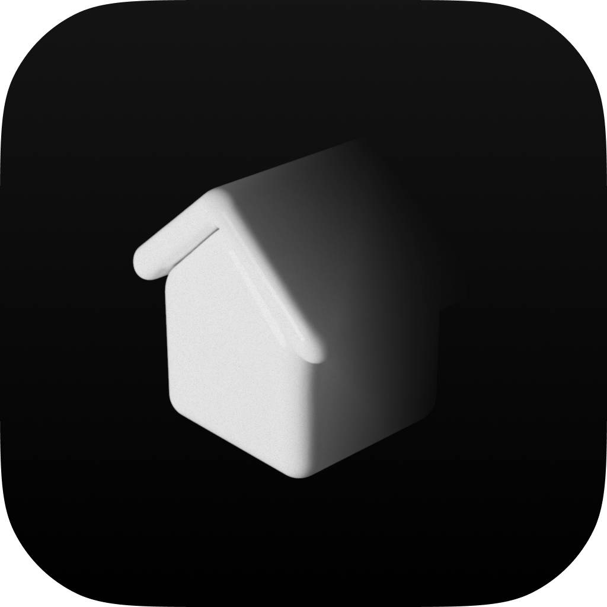

# Haus

[](https://github.com/resonaura/haus/releases/latest)
[](https://github.com/resonaura/haus/actions/workflows/build.yml)
[](#installation)
[](https://www.home-assistant.io/)
[](#development)
[](LICENSE)

A camera-first thoughtful home. Haus brings live cameras, room controls, scenes, integrations and add-ons together in a native-feeling app for macOS, Windows and Linux.

---

## Overview

Haus keeps the whole home close at hand: see cameras first, move through rooms and device categories, and control lights, switches, climate, security, media and more without losing context. Its dark interface uses careful color and glass effects while keeping controls clear and readable.

Authentication stays in Electron's main process, backed by OS-encrypted storage. Renderer APIs validate operations; OAuth credentials do not enter the UI. The browser preview uses a sample home and does not connect to your real devices.

## Features

- **Camera-first home view** with live streams, smoothly refreshed snapshots, snapshot age and a recording timeline over the video.
- **Whole-home browsing** across rooms and device categories, including cameras, printers and network devices exposed by Home Assistant.
- **Local room management** with room names/icons, device name/room settings and reviewed bulk moves that preserve individual control assignments by default.
- **Room-aware device controls** that show the capabilities a device actually supports, with optimistic state updates and stable tile positions.
- **Light controls** that reflect the current output color, brightness and color temperature; numbered fixtures can be grouped or kept separate.
- **Scenes organized by room**, with active-state highlighting, Home Assistant Hue palettes and independent Home view visibility.
- **Optional NVR nodes** for recording storage, media streaming and encrypted recovery copies, managed from Settings. NVR and Helper sources live in [`apps/node`](apps/node) and [`apps/hub`](apps/hub); see [camera, storage and recovery details](docs/nvr-development.md).
- **Integrations, device setup, add-on management and sensor history** in dedicated local workflows.
- **Haus helper** to discover camera-related sensors and keep event recordings available locally with a playback timeline.
- **Native desktop materials**: macOS Liquid Glass where supported and vibrancy on earlier versions; Windows acrylic; Linux blur only when the compositor reports it is enabled.

## Installation

Download a release for your operating system from [GitHub Releases](https://github.com/resonaura/haus/releases/latest).

### macOS

Install through the Homebrew tap:

```sh
brew tap resonaura/tap
brew install --cask haus
```

Or download the `.pkg` installer or `.dmg` directly. Haus is built without a paid Apple Developer ID or notarization. The package postinstall removes quarantine from the installed app; macOS may still ask you to confirm opening the installer. If you download the package directly and macOS blocks it, use Finder's **Control-click → Open** or follow the [platform notes](docs/platforms.md).

Haus currently requires macOS 13 Ventura or later.

### Windows

Run the `Haus-<version>-win-x64.exe` or `Haus-<version>-win-arm64.exe` installer for your processor. The installer offers a standard setup flow, install-location selection, Start menu entry and optional desktop shortcut.

### Linux

Choose an x64 or ARM64 package for your distribution:

| Package                  | Distributions                          |
| ------------------------ | -------------------------------------- |
| `.deb`                   | Debian, Ubuntu and derivatives         |
| `.rpm`                   | Fedora, RHEL, openSUSE and derivatives |
| `.pkg.tar.zst`           | Arch Linux and derivatives             |
| `.AppImage` or `.tar.gz` | Other distributions, including NixOS   |

For NixOS AppImage support, enable `programs.appimage` or use `appimage-run`. Haus adapts its sidebar to GNOME Blur my Shell, KDE Plasma's Blur effect and Hyprland blur settings when they are enabled. See the [platform notes](docs/platforms.md) for setup details.

## Home Assistant helper

Add the Haus repository (`https://github.com/resonaura/haus`) in Home Assistant's Apps/Repositories page, then install **Haus** to enable local camera event recording and sensor-assisted camera discovery. The add-on lives in [`apps/hub`](apps/hub).

## Development

Requirements: Node.js 24 and pnpm 11.

```sh
pnpm install --frozen-lockfile
pnpm dev
```

Run the isolated browser preview with sample data:

```sh
pnpm dev:web
```

Desktop lives in `apps/desktop`; root commands keep the same entry points. Shared device state lives in `packages/core` and `packages/state`. HomeKit/HKSV and reusable media validation live in the TypeScript ESM packages `packages/homekit` and `packages/media`. Haus Hub and Haus NVR are part of the same pnpm workspace and repository, with separate Dockerfiles, images and release lifecycles. Both server Dockerfiles build from the monorepo root and consume compiled shared packages using the single pnpm lockfile. `pnpm build:services` builds those packages for local server development. The HA-specific Python adapter stays in `custom_components/haus`, as required by HACS.

Run checks for the desktop, shared packages, Helper and NVR, then build the desktop app:

```sh
pnpm check
pnpm build
pnpm package
```

GitHub Actions checks the project and builds macOS, Windows and Linux packages for both x64 and ARM64. Push a `v*` tag to publish a release. See [desktop platform support](docs/platforms.md) for packaging, desktop effects, NixOS, macOS quarantine and installation notes.

See the [architecture guide](docs/architecture.md), [UX audit](docs/ux-audit.md) and [Home Assistant feature roadmap](docs/home-assistant-roadmap.md) for code boundaries, review findings and planned capabilities.

## License

Haus-authored code in this monorepo is licensed under the GNU General Public License v3.0 or later; see [LICENSE](LICENSE). Components retain their own third-party licenses and attributions in [THIRD_PARTY_NOTICES](THIRD_PARTY_NOTICES), including the Apache-2.0 Home Assistant JavaScript WebSocket client, OpenCV Zoo detector, Material Symbols, and the MIT-licensed adapted DuoBar geometry. Haus communicates with Home Assistant through its APIs and does not include Home Assistant Core source code.
