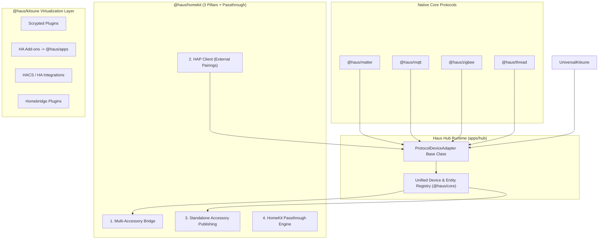
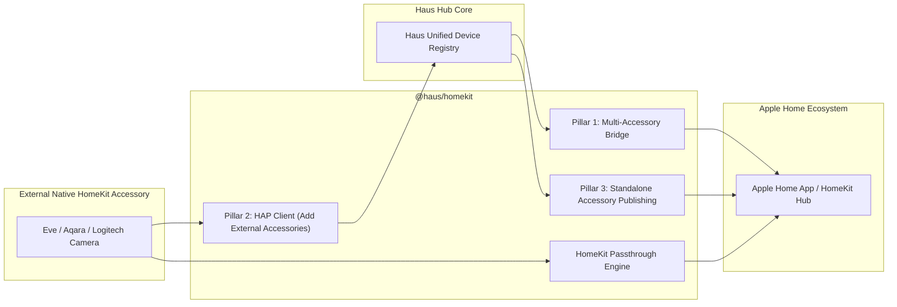
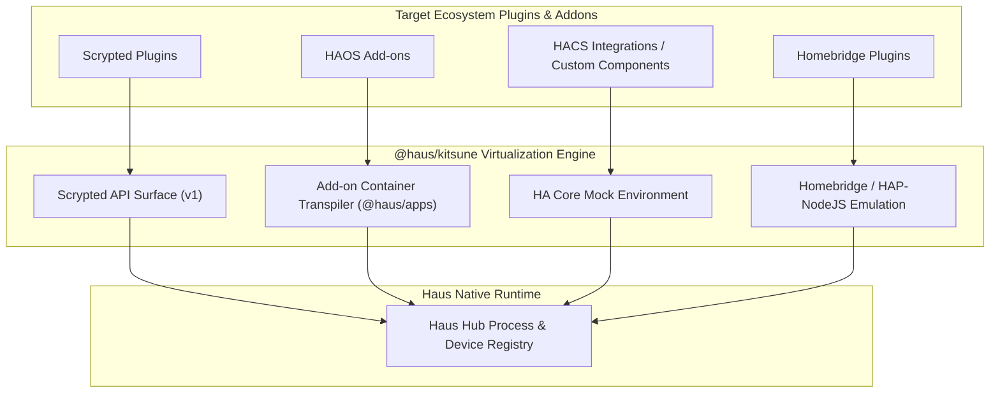

# Haus Unified Standards, Protocol Architecture, and Independence Roadmap

## 1. Executive Vision: Standalone Core From Day One

Haus is built to deliver a unified, high-performance, and resilient smart home platform that is **100% standalone at its core from day one**.

Home Assistant is **not** a foundational dependency to be phased out in the distant future — dragging HA as a core dependency creates accumulating legacy debt and architectural friction that becomes exponentially harder to untangle later. At its core, Haus Hub boots, discovers, configures, and controls devices (via native MQTT, Matter, Zigbee, Thread, HomeKit, and Apps) without requiring Home Assistant to run. Home Assistant is strictly treated as an optional external adapter and transitional migration source (`packages/ha`).

> [!IMPORTANT]
> **Operational Safety Boundary:**
> Development and verification must **never touch active household production NVR nodes or the existing household Home Assistant instance**. All experimental features, container lifecycles, and protocol adapters are tested strictly in local unit/integration mocks and on the isolated Black Laptop (`192.168.5.115`).

Relying on Home Assistant internally binds Haus to legacy architectural limitations, volatile upstream breaking changes, and unnecessary Python/OS resource overhead. By introducing native protocol engines (MQTT, Matter, Zigbee, Thread), universal plugin virtualization in `@haus/kitsune`, and a comprehensive Haus Device & Entity Standard, Haus achieves complete autonomy while preserving effortless access to existing smart home ecosystems.



---

## 2. Haus Unified Device and Entity Standard

Haus establishes its own native ontology and schema for devices and entities. Rather than adopting the quirks of any single external platform, the Haus standard synthesizes and expands upon:

1. **Home Assistant Entity Domains:** `light`, `switch`, `sensor`, `binary_sensor`, `climate`, `cover`, `fan`, `lock`, `camera`, `media_player`, `vacuum`, `valve`, `update`, `event`, `number`, `select`, `button`, `text`, `device_tracker`.
2. **Apple HomeKit Accessory & Service Categories:** Lightbulb, Outlet, Switch, Thermostat, Fan, Window Covering, Door Lock, Security System, Sensors (Motion, Contact, Leak, Smoke, Carbon Monoxide, Temperature, Humidity, Light), Video Doorbell, IP Camera, Television, Speaker.
3. **Haus-Native Infrastructure Categories:** Routers & Network Switches, Server & Compute Nodes, Storage & NAS Nodes, Smart Appliances & Kettles, Energy Storage & Battery/UPS Systems.

### 2.1 Device Categories (`DeviceCategory`)

Standardized high-level categories that determine UI presentation, primary telemetry, and interaction semantics:

- `lighting`: Dimmable lights, tunable white, full-color RGB/RGBW fixtures, light groups.
- `power`: Smart switches, wall plugs, relay modules, power distribution units.
- `climate`: Thermostats, AC units, heat pumps, humidifiers, dehumidifiers, radiant heaters.
- `security`: Smart locks, security alarm panels, access control keypads, safe boxes.
- `safety_sensors`: Smoke detectors, CO alarms, water leak sensors, gas detectors.
- `environmental_sensors`: Temperature, relative humidity, barometric pressure, ambient light (lux), air quality (VOC, PM2.5, PM10, CO2).
- `occupancy_sensors`: Passive infrared (PIR) motion, radar/mmWave presence, contact (door/window) sensors, vibration sensors.
- `covers`: Motorized roller shades, blinds, draperies, garage door openers, automated gates.
- `cameras`: Live RTSP/WebRTC streams, video doorbells, PTZ cameras, local NVR recording with HKSV.
- `media`: Smart speakers, TVs, streaming media receivers, multi-room audio zones.
- `appliances`: Robot vacuums, smart kettles, ovens, washing machines, dryers, dishwashers.
- `network`: Routers, access points, managed switches, mesh nodes, VPN gateways.
- `compute`: Hub nodes, edge compute servers, backup storage targets, worker nodes.
- `energy`: Solar inverters, grid energy meters, battery storage / home UPS, EV chargers.
- `generic`: Flexible containers for non-standard or compound devices.

### 2.2 Standard & Extensible Characteristics

Every device defines a primary category and a collection of **Endpoints** containing **Capabilities** and live **Readings**:

- **Standard Capabilities:** Well-known, type-safe traits (`on_off`, `brightness`, `color_temp`, `color_hsv`, `target_temperature`, `current_temperature`, `lock_state`, `motion_detected`, `stream_uri`, etc.).
- **Generic / Custom Entities:** Any device can have supplemental entities attached without breaking its primary classification. For example, a smart router device can expose:
  - Standard network telemetry (uplink/downlink bandwidth, connected clients).
  - Port switch entities (`switch.port_1_poe`, `switch.guest_wifi`).
  - Reboot and LED control buttons (`button.restart`, `switch.status_led`).
  - Storage sensors (`sensor.storage_usage`).

### 2.3 Event Entities & Stateless Programmable Switches (Wall Switches & Dials)

Wireless wall switches, button remotes, scene controllers, and rotary tap dials (e.g. Philips Hue Tap Dial, Hue Wall Switch, Aqara Wireless Mini Switch) are modeled as first-class **Event Entities**:

- **Haus Event Contract:** Endpoints expose stateless event streams with rich event payloads:
  - `event_types`: `['press', 'double_press', 'triple_press', 'long_press_start', 'long_press_release', 'rotate_left', 'rotate_right', 'rotate_stop']`.
  - Event metadata: `button_index` (for multi-button keypads 1..N), `rotation_steps`, `velocity`.
- **HomeKit Bridging:** Automatically maps each button endpoint to Apple HomeKit `StatelessProgrammableSwitch` services with `ServiceLabelIndex` and `ProgrammableSwitchEvent` (`0 = Single`, `1 = Double`, `2 = Long`), enabling users to bind native Apple Home automations to physical clicks.
- **Local Automation Triggers:** Reactive event bus dispatches events instantly without state polling, triggering local automation rules with sub-millisecond execution times.

### 2.4 Complete Entity & Service Equivalence Matrix

Validated against real-world production inventory (1,052 entities across 199 devices on user's active home):

| Home Assistant Domain       | HomeKit Service / Characteristic                     | Haus Standard Equivalent                                        |
| :-------------------------- | :--------------------------------------------------- | :-------------------------------------------------------------- |
| `light`                     | `Lightbulb` (On, Brightness, ColorTemp, Hue/Sat)     | `lighting` endpoint with `color_temp` (Kelvin), `color_hsv`     |
| `switch` / `outlet`         | `Switch` / `Outlet` (On, OutletInUse)                | `power` endpoint with `on_off` capability                       |
| `event` (buttons, remotes)  | `StatelessProgrammableSwitch`                        | `event` capability with discrete trigger types & button index   |
| `binary_sensor`             | `MotionSensor`, `ContactSensor`, `OccupancySensor`   | `occupancy_sensors` / `safety_sensors` with boolean traits      |
| `sensor`                    | `TemperatureSensor`, `HumiditySensor`, `LightSensor` | `environmental_sensors` / `telemetry` with typed units          |
| `climate`                   | `Thermostat`, `HeaterCooler`                         | `climate` endpoint with target/current temp and modes           |
| `water_heater`              | `Thermostat` (water heating mode)                    | `climate.water_heater` with target temp & boost                 |
| `camera` / `image`          | `CameraRTPStreamManagement`, `Doorbell`              | `cameras` endpoint with RTSP/WebRTC & HKSV support              |
| `media_player` / `remote`   | `Television`, `Speaker`, `SmartSpeaker`              | `media` endpoint with source, playback, volume controls         |
| `update`                    | Firmware / Software Update                           | `update` endpoint with progress %, release notes, auto-rollback |
| `eero` / network routers    | `Router` (Apple HomeKit Secure Router)               | `network` endpoint with bandwidth, client list, PoE ports       |
| `server` / compute nodes    | Not supported in HA/HomeKit                          | `compute` endpoint with CPU/GPU load, RAM, thermals             |
| `storage` / NAS pools       | Not supported in HA/HomeKit                          | `storage` endpoint with disk quotas, SMART, NVR space           |
| `energy` / battery backup   | Not supported in HA/HomeKit                          | `energy` endpoint with solar generation, battery SoC, UPS       |
| `appliance` (kettles, etc.) | Custom or generic switch in HA                       | `appliance` endpoint with temperature presets & keep-warm       |

---

## 3. Unified Protocol Device Adapter (`ProtocolDeviceAdapter`)

To prevent fragmented and protocol-specific handling across the codebase, all protocol drivers inherit from or implement the common `ProtocolDeviceAdapter` base class:

```ts
export abstract class ProtocolDeviceAdapter<TConfig, TDeviceMetadata> {
  abstract readonly protocolId: string;
  abstract start(config: TConfig): Promise<void>;
  abstract stop(): Promise<void>;

  // Device discovery & lifecycle
  abstract discoverDevices(): Promise<readonly DiscoveredDevice<TDeviceMetadata>[]>;
  abstract pairDevice(params: unknown): Promise<DiscoveredDevice<TDeviceMetadata>>;
  abstract removeDevice(deviceId: string): Promise<void>;

  // Unified command execution
  abstract executeCommand(
    deviceId: string,
    endpointId: string,
    capabilityId: string,
    operation: string,
    args: Record<string, unknown>,
  ): Promise<CommandReceipt>;

  // Event emission to Hub Registry
  protected emitDeviceDiscovered(device: HausDevice): void;
  protected emitDeviceStateChanged(deviceId: string, readings: Record<string, Reading>): void;
  protected emitDeviceAvailabilityChanged(deviceId: string, availability: Availability): void;
}
```

### 3.1 Protocol Implementations

1. **`MatterDeviceAdapter` (`@haus/matter`)**: Maps Matter endpoints and ZCL clusters to Haus devices and capabilities.
2. **`ZigbeeDeviceAdapter` (`@haus/zigbee`)**: Uses `zigbee-herdsman` to interview Zigbee devices, binding ZCL clusters into Haus endpoints.
3. **`MqttDeviceAdapter` (`@haus/mqtt`)**: Subscribes to generic and HA discovery payloads, translating MQTT state/command topics into Haus device contracts.
4. **`ThreadDeviceAdapter` (`@haus/thread`)**: Surfaces Thread mesh topology, router roles, and commissioning states into the Hub device registry.

---

## 4. HomeKit Architecture (`@haus/homekit`)

The `@haus/homekit` package is restructured into **3 distinct architectural pillars** plus a transparent **HomeKit Passthrough engine**:



### 4.1 Pillar 1: Multi-Accessory Bridge (`HAPBridge`)

- Publishes a standard HomeKit Bridge accessory to Apple Home.
- Aggregates Haus-managed devices (lights, switches, sensors, locks, shades, thermostats) into a single paired bridge.
- Automatically handles accessory addition, removal, and characteristic change broadcasts.

### 4.2 Pillar 2: HomeKit Client (`HAPClient`)

- Enables Haus to act as a **HomeKit Controller**.
- Users can pair external native HomeKit accessories directly to Haus (e.g. Eve Energy, native HomeKit door locks, HomeKit cameras).
- Discovers accessories via Bonjour/mDNS (`_hap._tcp`), executes HAP cryptographic pairing (SRP, ChaCha20-Poly1305, Ed25519), and ingests all exposed HAP services and characteristics as native Haus devices and endpoints.

### 4.3 Pillar 3: Standalone Accessory Publishing (`HAPStandalone`)

- Dedicated single-accessory server for high-bandwidth or specialized hardware that Apple Home requires as standalone accessories:
  - IP Cameras with HomeKit Secure Video (HKSV) and two-way talkback.
  - Video Doorbells with chimes and motion events.
  - HomeKit-certified Smart Routers and Wi-Fi management profiles.
  - Standalone Thermostats and Locks.
- Covers the full catalog of Haus device types mapped directly to HAP Accessory categories.

### 4.4 HomeKit Passthrough (`HAPassThrough`)

- When a user adds an external native HomeKit device to Haus via the **HAP Client**, Haus can simultaneously:
  1. Ingest its telemetry, events, and controls into the Haus Hub registry for local automations and historical logging.
  2. **Pass through** the raw HAP characteristics, secure video streams, and proprietary vendor attributes to Apple Home or downstream controllers.
- Ensures zero degradation of Apple-specific features (including HKSV facial recognition, rich notifications, and firmware updates).

---

## 5. Kitsune Universal Virtualization Roadmap (`@haus/kitsune`)

To eliminate Home Assistant and external runtime dependencies, `@haus/kitsune` expands its plugin and container virtualization to support 4 major smart home ecosystems:



### 5.1 Scrypted Virtualization

- Native video pipelines, ONVIF/RTSP cameras, P2P cameras (Eufy, Tuya), WebRTC two-way audio, and HKSV fMP4 encoding.
- Already operational via `@haus/kitsune/sdk/v1`.

### 5.2 Home Assistant Add-ons to Haus Apps

- HAOS add-ons are converted into containerized Apps running under `@haus/apps`.
- Ingress, options schemas, and internal network namespaces are handled natively by Haus without Supervisor or Docker socket exposure.

### 5.3 HA Marketplace / HACS Virtualization

- Many integrations only exist as HA custom components (`custom_components/*`).
- Kitsune introduces a virtualized Home Assistant integration harness:
  - Exposes mock `homeassistant.core.HomeAssistant`, `ConfigEntry`, `DataUpdateCoordinator`, and entity registry APIs.
  - Third-party integrations run unmodified, thinking they are inside Home Assistant, while their entity states and service calls map directly into the Haus Device & Entity Registry.

### 5.4 Homebridge Plugin Virtualization from Day One

- **In-Memory HAP Interception:** Virtualizes `API.registerAccessory`, `API.registerPlatform`, and `API.publishExternalAccessories` from `homebridge-*` NPM plugins. Haus captures accessory objects directly in memory, translating services and characteristics into native Haus devices (`HausDevice`) for instant UI and automation access.
- **Child Bridge Subprocess Isolation:** Child bridges (`_bridge`) run inside dedicated Node.js child processes on distinct TCP ports. A crash or hanging event loop in one third-party plugin cannot crash the Hub or degrade other devices.
- **Log Interceptor & Automatic Pairing Cards:** Legacy plugins often print 8-digit setup PINs (`\d{3}-\d{2}-\d{3}`) or ASCII QR codes to stdout. The Kitsune log interceptor automatically regex-extracts these setup payloads and renders interactive UI Pairing Cards, eliminating the need for terminal inspection.

### 5.5 Add-on Inter-Dependencies and Service Sharing

- **Topological Startup DAG:** Add-on manifests declare service dependencies (`services: ["mqtt:need"]`). Haus computes a topological dependency graph, guaranteeing providers (e.g. native MQTT broker) start and pass health checks before consumers (e.g. Zigbee2MQTT) initialize.
- **Automatic Service Injection:** Required service endpoints (`MQTT_HOST`, `MQTT_PORT`, credentials) are injected into container environments and exposed via the emulated Supervisor Service API (`GET /services/mqtt`).
- **Internal Container Mesh:** Managed container Apps communicate over an isolated Docker network bridge using stable container DNS aliases.

---

## 6. Architectural Invariants

1. **Strict Composition Over Monoliths:** Stateful services compose through constructor injection. Protocols implement `ProtocolDeviceAdapter` without deep inheritance hierarchies.
2. **Zero POSIX-Hardcoded Paths:** All persistent state, socket paths, and cache directories are OS-agnostic and configured via environment and Host options.
3. **No Direct HA Core Dependency in Core Packages:** Core contracts, state management, and protocols never import `@haus/ha`. HA is treated strictly as one of many adapters.
4. **Deny-by-Default Security:** All external virtualized plugins (HACS, Homebridge, Scrypted) run under sandboxed permissions and bounded communication channels.

---

## 7. Deep Engineering Invariants and Edge Cases

### 7.1 HomeKit Protocol Termination and Determinism

- **HAP Crypto Termination in Passthrough:** HAP pairs using ephemeral Curve25519 session keys via ChaCha20-Poly1305. Passthrough cannot be a raw TCP pipe; Haus decrypts incoming HAP frames on the HAP Client, synchronizes Haus device registry state, and re-encrypts characteristics for Apple Home clients over the HAP Server session.
- **Persistent IID Stability:** Apple Home caches numeric Instance IDs (`iid`) permanently. Every Service and Characteristic maps to a deterministically persisted IID in SQLite: `(accessory_id, service_type, subtype, char_type) -> persistent_iid`. IIDs never shift across Hub reboots or schema migrations.
- **mDNS TXT Record Bounds:** Strict 380-byte size ceiling on `_hap._tcp` TXT records (Apple/RFC 400-byte hard limit) with model name hashing and truncation to prevent silent device discovery failure on iOS.
- **Topology Hashing for Configuration Number `c#`:** The `c#` configuration number increments strictly upon a verified SHA-256 hash delta of the accessory's service/characteristic tree, avoiding destructive iOS cache invalidation loops.
- **HKSV Keyframe Recovery:** Network transitions (Wi-Fi to cellular via Apple TV) trigger RTCP PLI/FIR feedback; `@haus/media` intercepts feedback and injects I-frames from ring buffers without video freezing.
- **Talkback Audio Resampling:** Bidirectional audio from Apple Home (Opus/AAC-ELD) is decoded and transcoded in real-time to G.711u/PCMA 8kHz for camera backchannels.

### 7.2 Device Standards, Units, and High-Frequency Telemetry

- **Multi-Gang Endpoint Room Independence:** Physical composite devices (e.g. 6-port surge protectors) decouple the physical host (`Device`) from its addressable functional units (`Endpoints`). Each endpoint holds an independent canonical address `type::area:device:entity`, allowing sockets on a single physical unit to reside in different rooms.
- **Absolute Physical Units:** Kelvin is the internal authority for color temperature ($Mireds = 1\,000\,000 / K$ is computed on the fly for HomeKit without precision drift); color space is normalized $HSV \in [0..360, 0..100, 0..100]$; temperature is Celsius.
- **Deadband Filtering and Throttling:** High-frequency sensors (power meters, accelerometers) pass through deadband filters ($\Delta \ge threshold$) and ring-buffer throttling before emitting bus events or writing SQLite history, protecting database WAL logs from disk wear and CPU starvation.
- **Optimistic State with Command Coalescing:** UI transitions track `pending_acknowledgement` status. Multiple rapid user toggles on the same capability coalesce in adapter queues using LIFO replacement to prevent relay chatter and race conditions.
- **Standardized UI Primitives:** Custom entities expose typed UI primitives (`toggle`, `slider`, `stepper`, `dropdown`, `gauge`, `chart`) with validation ranges, allowing clients to render interactive controls automatically.

### 7.3 Radio Port Exclusivity, Network Interfaces, and Hardware Continuity

- **Serial Port Mutual Exclusion:** Radio dongles (`/dev/ttyUSB0`) enforce exclusive access via OS-level locks (`flock`) and explicit `SERIAL_PORT_BUSY` error states when another daemon holds the port, supporting fallback to TCP network serial bridges (`tcp://host:port`).
- **NVRAM Radio Network Continuity:** Zigbee network parameters (`panId`, `extPanId`, `channel`, `networkKey`) persist in the Hub's encrypted SQLite vault, enabling coordinator dongle hardware replacement without re-pairing mesh devices.
- **Radio OTA Safety:** Firmware upgrades over Zigbee (`0x0019 genOta`) and Matter chunked transfers support resume, integrity validation, and coordinator power-down guards.
- **Zigbee Group Multicast (Anti-Popcorn):** Coordinated lighting groups broadcast via ZCL Groups (`0x0004`) and Scenes (`0x0005`) clusters simultaneously, switching dozens of fixtures in the exact same millisecond rather than sequencing laggy unicast packets.
- **Stale MQTT Discovery Purge:** Device removal or rebinding issues retained tombstone payloads (`payload: ""` with `retain: true`), preventing phantom devices from reappearing across Hub restarts.
- **Multi-NIC mDNS Interface Pinning:** mDNS advertises strictly on the primary physical LAN interface, explicitly filtering out Docker bridge networks (`172.16.0.0/12`, `docker0`) and virtual subnets to prevent Apple Home and Matter connectivity drops.
- **NTP Cold-Start Resilience:** For hosts without hardware RTC batteries booting offline (system time `1970-01-01`), client connection handshakes provide trusted epoch timestamps (`X-Haus-Client-Time`) to set system clock before initializing Matter/TLS certificate validation.
- **Non-Blocking SQLite Architecture:** Time-series telemetry and long-range historical queries run across worker threads with isolated read-only SQLite connections, ensuring heavy analytics never block the Node.js event loop or cause serial buffer overruns for radio coordinators.

### 7.4 Virtualization Sandbox Isolation

- **Python Sidecar Process Bounds:** HACS custom integrations run inside an isolated Python sidecar process with OS resource limits (`setrlimit`/`cgroups`), IPC communication over Unix domain sockets, and a 30-second setup timeout guarding the Hub from unresponsive third-party code.
- **Supervisor API and Ingress Emulation:** Containerized HA Add-ons run under `@haus/apps` with an emulated Supervisor endpoint (`/addons/self/options`, `/services/mqtt`, `/discovery`) and full WebSocket upgrade proxying with subpath rewriting.

### 7.5 Interactive Flows, Updates, Notifications, and Repairs

- **Interactive Dialogs (`InteractiveFlow`):** Multi-step configuration forms, 2FA SMS/PIN countdowns with auto-resend, OAuth popup/custom-tab redirects with local deep-link callbacks, non-destructive reauth on `ConfigEntryAuthFailed`, and device options flows.
- **First-Class Update Domain:** `update` entities track installed/latest versions, download progress ($0..100\%$), changelog summaries, and container/firmware `install(backup)` actions with automatic rollback on crash.
- **Actionable Notifications & Repairs:** Critical mobile push notifications bypassing DND with embedded camera snapshots and interactive lockscreen action callbacks; central Repairs Registry (`SystemIssue`) with 1-click interactive resolution flows.

---

## 8. Multi-Hub Architecture from Day One

Haus is designed from the very first line of code for multi-hub environments, eliminating single points of failure and cloud dependencies:

1. **Independent Autonomous Nodes:** Every Haus Hub is a fully capable, standalone instance. A home functions with 1, 2, or N Hubs without requiring a cloud witness, external database, or third-party quorum.
2. **Resource-Level Single-Authoritative Writers:**
   - **Hardware Dongle Affinity:** Physical radio coordinators (Zigbee USB stick on `/dev/ttyUSB0`) are bound to the specific Hub host they are plugged into. Other Hubs route commands via the internal Haus Fabric RPC.
   - **Exclusive Token Owners:** Each cloud integration session (e.g. Spotify, Eufy) has exactly one designated Hub owner responsible for token rotation, preventing race conditions.
   - **Local Execution Continuity:** Automations targeting devices connected to a Hub execute locally on that Hub. If the network splits or the coordinator Hub reboots, local automations continue to fire with zero latency and zero dependency on peer Hubs.
   - **HomeKit Identity Pinning:** A HomeKit bridge or standalone accessory identity is pinned to one physical Hub machine, maintaining persistent pairing and preventing iOS "No Response" during coordinator elections.
3. **Partition & Split-Brain Fencing:**
   - On network partition, each Hub retains its local device assignments.
   - Promotion of a new owner for an exclusive resource requires verifiable cryptographic fencing and lease generation increments (`generation++`), blocking duplicate physical commands or conflicting token refreshes.
   - Non-secret configuration (rooms, user roles, device aliases) replicates lazily across Hubs; secrets remain strictly in local hardware-encrypted vaults.

---

## 9. Mobile & Desktop Device Onboarding, QR Scanning, and Matter Multi-Admin Sharing

### 9.1 Unified Local Network Discovery

Both desktop and mobile clients support active and passive device discovery across the local subnet:

- **mDNS / DNS-SD Browsing:** Discovers uncommissioned Matter devices (`_matterc._udp`), unconfigured HomeKit accessories (`_hap._tcp` with status flag `sf=1`), ESPHome nodes (`_esphomelib._tcp`), Philips Hue bridges (`_hue._tcp`), and Sonos players (`_sonos._tcp`).
- **SSDP / UPnP Discovery:** Scans for media renderers, smart TVs, and network routers.
- **BLE Probing (Mobile):** Detects nearby uncommissioned Matter-over-Thread and native HomeKit Bluetooth accessories during initial setup.

### 9.2 Mobile Camera QR Scanner (Matter & HomeKit)

The mobile app (`apps/mobile`) includes an integrated high-performance camera QR scanner:

- **Matter QR Payloads (`MT:...`):** Decoded using `@matter/main`'s `QrPairingCodeCodec`. Extracts Vendor ID (VID), Product ID (PID), 12-bit Discriminator, and 27-bit Passcode, automatically launching PASE (Password Authenticated Session Establishment) over BLE or IP.
- **HomeKit QR Payloads (`X-HM://...`):** Decodes Base36 setup URIs, extracting Category ID, 4-character Setup ID, and 8-digit Setup Code (`XXX-XX-XXX`) for SRP pairing.
- **Manual Numeric Fallback:** Seamless input for 11/21-digit Matter manual pairing codes and 8-digit HomeKit PINs on both Desktop and Mobile.

### 9.3 Matter Multi-Admin Sharing (Outward & Inward)

Matter devices support simultaneous membership in multiple independent fabrics (Apple Home, Google Home, Alexa, Haus):

- **Sharing Outward from Haus:**
  1. User selects a Matter device in Haus and taps _"Share Device / Add to Another Ecosystem"_.
  2. Haus calls `AdministratorCommissioningCluster.openCommissioningWindow` on Endpoint 0 of the device.
  3. Haus generates a temporary random setup passcode, 12-bit discriminator, manual 11-digit setup code, and Matter QR code (`MT:...`).
  4. The UI displays the QR code and 11-digit code with an active expiration timer (e.g. 15 minutes).
  5. The user scans the QR code in Apple Home or Google Home, seamlessly adding the device to their second ecosystem without disconnecting from Haus.
- **Importing Inward from Other Ecosystems:**
  - If a device was first commissioned into Apple Home or Google Home, user turns on "Pairing Mode" in that app and enters the generated code into Haus, establishing dual-fabric control.

---

## 10. Hardware-Linked Keychain, Zero-Trust Auth, and Multi-Transport Discovery

### 10.1 Platform Keychain Synchronization

Haus implements a hardware-backed cryptographic vault linked directly to operating system keychains:

- **Apple Platforms (iOS / macOS):** Uses Apple Keychain Services API via `expo-secure-store` and `keytar` with biometric protection (`kSecAccessControlBiometryAny` / Touch ID / Face ID).
- **Windows:** Hardware-encrypted DPAPI / Windows Credential Manager.
- **Linux:** FreeDesktop Secret Service API (`libsecret` / GNOME Keyring / KWallet).
- **Storage Scope:** Refresh tokens, private device passwords, Matter fabric certificates, Zigbee network keys, and HAP pairing secrets.

### 10.2 Zero-Trust Security & Seamless New-Device Authorization

- **Local Approval Prompt:** Opening Haus on a new device on the local network initiates a secure challenge handshake. An already-authenticated phone/PC receives an immediate local push prompt: _"Authorize new login from MacBook Pro on local network? [Approve / Deny]"_ accompanied by a 4-digit verification code.
- **Cryptographic Backup Codes:** Single-use offline recovery codes are generated at Hub onboarding, enabling emergency administrative access if all paired client devices are lost.
- **Revocable Scoped Tokens:** Every paired client holds an independently revocable session token, isolating compromised devices without forcing home-wide re-pairing.

### 10.3 Multi-Transport Hub Discovery (BLE + Wi-Fi / Ethernet)

- **Ethernet / Wi-Fi LAN:** Fast mDNS service browsing (`_haus._tcp`) with automatic IP resolution.
- **Bluetooth LE GATT Pairing:** Unconfigured or offline Hubs advertise a dedicated BLE GATT service, enabling mobile clients to discover, configure network credentials, and pair with Hubs before Wi-Fi is configured.

---

## 11. Zero-Loss Verified Migration Pipeline (Active HA & Legacy Haus)

To safely migrate the 1,052 entities and 199 devices from the user's active Home Assistant (`192.168.4.44`) and legacy Haus:

1. **Parallel Verification Before Cutover:** The new standalone Haus runtime initializes all protocol adapters and performs dry-run device interviews alongside the active system without altering its state.
2. **"Verify Before Stop" Gate:** Strict operational invariant: _"Перед остановкой старого убедиться что новое всё ожило"_. Old services are never terminated until the new node proves 100% telemetry freshness, successful ping/query responses, and green health checks across all devices.
3. **Attended Cutover:** Seamless handover of serial radio dongles (Zigbee) and IP bindings, backed by immediate rollback checkpoints.

---

## 12. Shared UI Library and Web Client Roadmap

Carefully scheduled at the end of the roadmap (Milestone 8) to maintain stability:

- **Shared UI Component Library (`packages/ui`):** Cross-platform design tokens, interactive controls, and dynamic entity widgets shared across Desktop (Electron) and Mobile (Expo) without regressing platform-specific behaviors.
- **Standalone Web Client:** High-performance responsive web dashboard served directly by the Hub HTTP server (`/`), reusing the shared UI component library.
