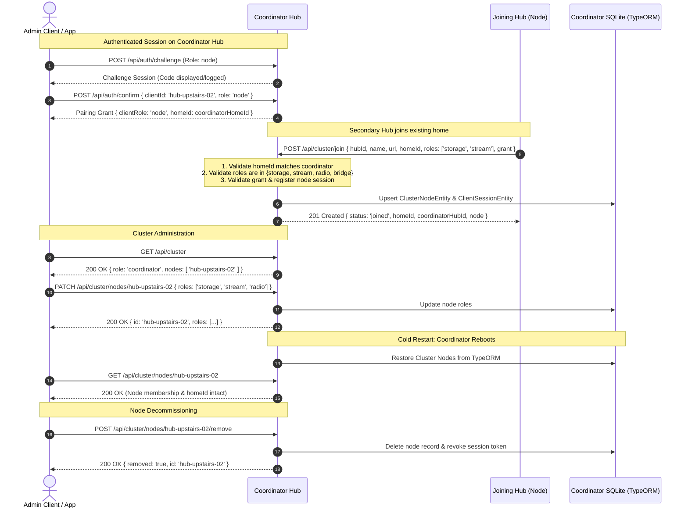

# Multi-Hub Cluster Join & Home Identity Preservation — P19.2

Documented architecture, security boundaries, and test verification for adding a secondary Hub to an existing Haus home cluster with mutual authorization and bounded permissions (`P19.2`).

---

## 1. Security & Distributed Invariants

1. **Coordinator Home Identity Authority:**
   - In a multi-Hub household topology, the primary coordinator Hub owns the canonical household identity (`homeId`).
   - When a secondary Hub joins the existing home, it does not create a fragmented home partition; it adopts and shares the coordinator's `homeId`.
   - Any join request presenting a mismatched `homeId` is rejected fail-closed with `403 Forbidden` (`wrong_home`).

2. **Explicit Bounded Node Roles:**
   - Joining Hubs and nodes cannot claim arbitrary permissions or superuser roles.
   - Node roles are explicitly bounded to valid operational capabilities:
     `VALID_CLUSTER_ROLES = new Set(['storage', 'stream', 'radio', 'bridge'])`
   - Attempting to join with unauthorized or escalated roles (e.g., `admin`, `superuser`, `root`) is rejected with `400 Bad Request` (`invalid_node_roles`).

3. **Cryptographic Pairing Grant Enforcement:**
   - When a pairing grant is provided during join, `HubAuthService.validatePairingGrant()` strictly checks grant expiry, matching `homeId`, and matching `clientRole: 'node'`.
   - Secondary Hub credentials are registered in SQLite as a `ClientSessionEntity` under role `'node'`, preventing privilege escalation across the cluster API.

4. **Persistence & Lifecycle Isolation:**
   - Node membership, configured URLs, bounded roles, and shared `homeId` persist across cold restarts in SQLite via TypeORM `ClusterCatalogEntity`.
   - Node removal via `POST /api/cluster/nodes/:id/remove` atomically deletes the node record from the cluster catalog and revokes associated client credentials in `HubAuthService`.

---

## 2. Cluster Join Workflow

---

## 3. Observed Verification Evidence

`apps/hub/test/standalone/cluster-join.test.ts` exercises the complete multi-Hub join and lifecycle contract:

1. **Coordinator Boot & Admin Onboarding:**
   - Started primary Hub with clean data directory. Onboarded admin client via `challenge` → `confirm` → `pair`.
   - Cluster status verified as standalone coordinator (`initialStatus.role === 'coordinator'`) with zero secondary nodes.
2. **Node Pairing Grant Generation:**
   - Coordinator issued a scoped pairing grant specifically for `hub-upstairs-02` with `clientRole: 'node'` and matching `homeId`.
3. **Wrong-Home Invariant Verification:**
   - Rogue Hub presenting `homeId: 'home-different-household'` called `POST /api/cluster/join`.
   - Invariant verified: Fail-closed rejection with `403 Forbidden` (`{ error: 'wrong_home' }`).
4. **Invalid-Role Invariant Verification:**
   - Hub requesting escalated roles (`['superuser', 'admin']`) called `POST /api/cluster/join`.
   - Invariant verified: Rejection with `400 Bad Request` (`{ error: 'invalid_node_roles' }`).
5. **Successful Cluster Join:**
   - Secondary Hub joined with valid grant and bounded roles (`['storage', 'stream']`).
   - Verified response: `status: 'joined'`, `homeId: coordinatorHomeId`, node marked enabled and online.
6. **Cluster Status & Node Details:**
   - `GET /api/cluster` reports secondary Hub in `nodes` array with matching `homeId`.
   - `GET /api/cluster/nodes/hub-upstairs-02` returns detailed node record.
7. **Dynamic Capability Updates:**
   - `PATCH /api/cluster/nodes/hub-upstairs-02` updated capabilities to `['storage', 'stream', 'radio']`.
8. **Cold Restart Persistence:**
   - Hub closed completely and restarted against the same data directory.
   - Node membership, updated roles (`storage`, `stream`, `radio`), and shared `homeId` restored intact from TypeORM SQLite without requiring re-join.
9. **Node Removal & Credential Revocation:**
   - `POST /api/cluster/nodes/hub-upstairs-02/remove` cleanly decommissioned the node, returning `nodes: []` on subsequent queries.
