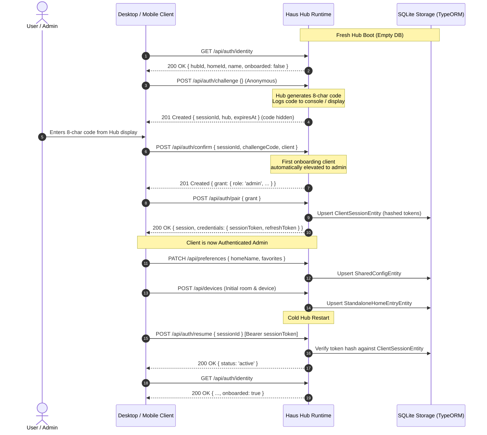

# First-Hub & Standalone Home Onboarding — P19.1

Documented architecture, security invariants, and test verification for bootstrapping a clean standalone Haus home on a fresh Hub without Home Assistant Core, Supervisor, prototype credentials, or manual developer setup (`P19.1`).

---

## 1. Security & Standalone Invariants

1. **Zero Home Assistant Dependency:**
   - In standalone mode (`mode: 'standalone'`, `standalone: true`), Hub never requires Home Assistant Core, Supervisor tokens, or appliance overlays.
   - `StandaloneHaClient` runs in-memory with disconnected state (`connected: false`), returning empty registries (`{ states: [], entities: [], devices: [], areas: [] }`) and throwing `ha_disconnected` on service requests without attempting external network connections.
2. **Zero Prototype Fixture Credentials:**
   - No hardcoded `ADMIN_TOKEN`, fixed bearer strings, or prototype credentials exist in runtime code.
   - Without an explicit environment override, `loadConfig()` generates cryptographic random bytes (`randomBytes(24).toString('hex')`) for internal API tokens.
   - Client session tokens and refresh tokens are cryptographically generated (`randomBytes(32).toString('hex')`) and persisted to SQLite exclusively as SHA-256 hashes (`token_hash`, `refresh_token_hash`), never plaintext.
3. **Fail-Closed Default State:**
   - A fresh standalone Hub starts with `onboarded: false` in `GET /api/auth/identity`.
   - All protected domain endpoints (`/api/devices`, `/api/scenes`, `/api/automations`, `/api/preferences`) immediately reject unauthenticated or fixture requests with `401 Unauthorized`.

---

## 2. Native Onboarding & Pairing Workflow

The onboarding lifecycle reuses the native zero-config pairing protocol (`challenge` → `confirm` → `pair` → `resume`):

---

## 3. Observed Verification Evidence

`apps/hub/test/standalone/onboarding.test.ts` exercises the complete first-Hub/home onboarding contract:

1. **Clean Cold Boot:**
   - Started a clean NestJS Hub on an empty temporary directory with all HA and auth environment variables explicitly unset.
   - Invariant verified: `StandaloneHaClient.connected === false`, `/health` returns `mode: 'standalone'`, and `GET /api/auth/identity` reports `onboarded: false`.
2. **Access Control Verification:**
   - Protected endpoints (`/api/devices`, `/api/scenes`, `/api/automations`, `/api/preferences`) reject anonymous and invalid bearer requests with `401`.
3. **Anonymous Challenge Protection:**
   - Anonymous caller calls `POST /api/auth/challenge`.
   - Verified that `challengeCode` is undefined in the HTTP response body and securely retained in `HubPairing` session records for local display.
4. **First-Client Admin Elevation:**
   - Client confirms with the 8-character code. Because the home has zero existing admin sessions, the grant is issued with `clientRole: 'admin'`.
   - Client calls `POST /api/auth/pair`, receiving `sessionToken` and `refreshToken`.
   - Identity inspection shows `onboarded: true`.
5. **Initial Household Customization:**
   - Admin client patches preferences via `PATCH /api/preferences` to set `homeName: 'The Solarium'` and registers the first device via `POST /api/devices`.
6. **Token Hashing Invariant:**
   - Read SQLite directly via `DatabaseSync`: verified `token_hash` and `refresh_token_hash` are 64-hex SHA-256 strings and neither raw token appears in plaintext.
7. **Cold Restart Resumption:**
   - Hub stopped completely and restarted on the same data directory.
   - Client resumes via `POST /api/auth/resume` with `Bearer <sessionToken>`.
   - Resumed session is active, `homeName: 'The Solarium'` and registered devices are intact, and `onboarded: true` persists without requiring re-pairing.
8. **Token Rotation:**
   - Client rotates credentials via `POST /api/auth/refresh`, receiving a fresh bearer token.
