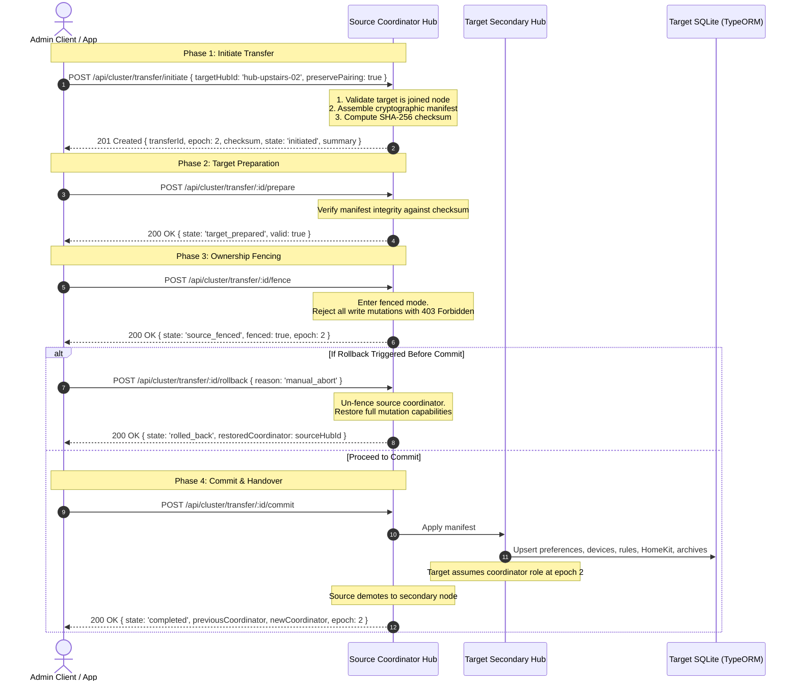

# Hub-to-Hub Transfer with Ownership Fencing & Pairing Preservation — P19.3

Documented architecture, security boundaries, and test verification for executing a deliberate, recoverable transfer of household coordinator ownership between Hubs (`P19.3`).

---

## 1. Security & Distributed Invariants

1. **Deliberate 5-Phase Transfer Lifecycle:**
   - A Hub transfer is never an implicit, automatic failover that risks split-brain or divergent writes.
   - The transfer follows an explicit, five-step state machine:
     `initiated` → `target_prepared` → `source_fenced` → `completed` (or `rolled_back`).
   - Every phase validates prerequisites, source authority, target presence, and state transitions.

2. **Ownership Fencing & Epoch Invariant:**
   - At any moment, exactly one Hub holds active coordinator status for a household (`homeId`).
   - A monotonically increasing fencing epoch (`coordinatorEpoch`) governs coordinator authority.
   - When the transfer enters the `source_fenced` state:
     - The source coordinator enters `fenced: true`.
     - All write mutations on the source (`POST /api/devices`, `PATCH /api/preferences`, `POST /api/scenes`, `POST /api/automations`, `POST /api/cluster/nodes`) are rejected fail-closed with `403 Forbidden` (`coordinator_fenced`).
     - Read-only operations (`GET /api/devices`, `GET /api/states`, `GET /api/cluster`) remain accessible and truthfully reflect `fenced: true`.
     - Background advertisements on the source Hub (such as HomeKit mDNS advertising) are suppressed to prevent duplicate network advertisements.

3. **Secrets & Pairing Preservation:**
   - Sensitive HomeKit pairing identities (`HomeKitIdentityEntity`), bridge credentials, setup IDs, and PINs are preserved in the transfer manifest. Apple Home controllers remain paired and do not require re-pairing.
   - Admin client sessions (`ClientSessionEntity`) with hashed tokens are preserved, allowing administrators to seamlessly resume active sessions on the new coordinator without force-logout.

4. **Preserved Devices, Rules, and NVR Archives:**
   - Devices, endpoints, capabilities, and states (`StandaloneHomeEntryEntity` kind `device` and `endpoint_state`) are transferred with unchanged IDs.
   - Scenes, scripts, and automations (`StandaloneHomeEntryEntity` kind `scene`, `script`, `automation`) are transferred intact.
   - Household preferences and `homeName` (`SharedConfigEntity`) are transferred.
   - NVR recording archives and node locations (`BackupEntity`, `ClusterLocationEntity`, `ClusterMediaEntity`) are preserved, ensuring historical event footage and playback remain intact without rewriting.

5. **Deliberate Recoverable Rollback:**
   - If the transfer is aborted or fails before final commit, calling `POST /api/cluster/transfer/:id/rollback`:
     - Releases the fence lock on the source coordinator (`fenced: false`).
     - Restores full mutation capabilities on the source coordinator.
     - Discards staged state on the target Hub.
     - Sets state to `'rolled_back'` with an explicit rollback reason.

---

## 2. Transfer Workflow Sequence

---

## 3. Observed Verification Evidence

`apps/hub/test/standalone/hub-transfer.test.ts` exercises the complete Hub-to-Hub transfer contract:

1. **Dual Hub Boot & Cluster Setup:**
   - Started primary coordinator Hub (`hub-standalone-01`) and secondary node Hub (`hub-upstairs-02`) on isolated disposable data directories.
   - Onboarded admin client on primary Hub, customized `homeName: 'The Solarium'`, registered devices (`dev-light-living`), endpoint states, scenes (`scene-evening`), automations (`rule-motion`), HomeKit identities (`cam-outdoor-01`), and NVR recording archives (`BackupEntity`, `ClusterLocationEntity`).
   - Secondary Hub joined cluster as a secondary node (`clientRole: 'node'`).
2. **Transfer Initiation:**
   - Admin called `POST /api/cluster/transfer/initiate` with `targetHubId: 'hub-upstairs-02'`.
   - Verified response: state `'initiated'`, `epoch: 2`, summary counts matching registered entities, and deterministic SHA-256 checksum.
3. **Target Preparation:**
   - Called `POST /api/cluster/transfer/:id/prepare`, verified manifest integrity against checksum, yielding state `'target_prepared'`.
4. **Ownership Fencing Invariant:**
   - Called `POST /api/cluster/transfer/:id/fence`, setting `fenced: true` and state `'source_fenced'`.
   - Verified fail-closed rejection: `POST /api/devices` and `PATCH /api/preferences` immediately failed with `403 Forbidden` (`coordinator_fenced`).
   - Verified read-only access: `GET /api/cluster` succeeded (`200 OK`) and reported `fenced: true` and `role: 'fenced'`.
5. **Recoverable Rollback:**
   - Called `POST /api/cluster/transfer/:id/rollback`, verifying state `'rolled_back'` and restored coordinator authority.
   - Verified source coordinator un-fenced (`fenced: false`, `role: 'coordinator'`) and write operations succeeded again.
6. **Full Transfer Commit & Handover:**
   - Re-initiated, prepared, fenced, and called `commit`.
   - Manifest applied to target TypeORM database: target elevated to `role: 'coordinator'` at `epoch: 2`.
   - Source coordinator demoted to `role: 'node'`, pointing to the new coordinator with fence lock released.
7. **Preserved Entity Verification on New Coordinator:**
   - Target Hub reloaded state: `homeName`, `dev-light-living`, `scene-evening`, and `rule-motion` verified intact with exact IDs.
   - HomeKit identity (`cam-outdoor-01`) and pairing keys verified in target SQLite.
   - NVR recording archive (`BackupEntity`) verified in target SQLite.
8. **Cold Restart Persistence:**
   - Target Hub cold restarted on `targetDir`, verifying that coordinator status, devices, scenes, and automations persisted completely across cold reboot.
