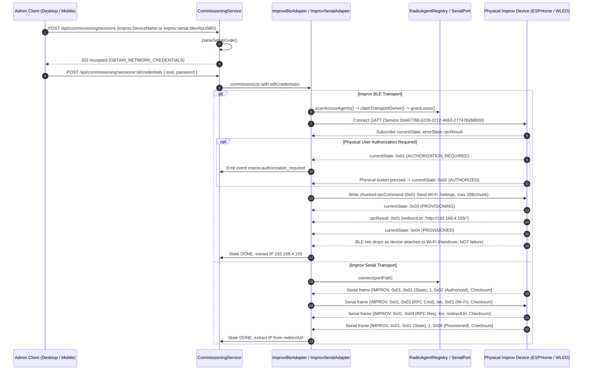

# Improv BLE and Serial Provisioning (P20.6)

Updated: 2026-11-12. Milestone 20 verification evidence for code-first Improv Wi-Fi device onboarding over Bluetooth Low Energy (BLE) and Serial UART.

## Architecture & Lifecycles

Haus implements the official Improv Wi-Fi specification across both BLE GATT and Serial framing transports. The core protocol codec (`@haus/core`) is transport-neutral, while `@haus/hub` provides specialized `ImprovBleAdapter` and `ImprovSerialAdapter` components coordinated by `CommissioningService`.

## Security Boundaries & Protocol Invariants

1. **Official BLE Specification Compliance:**
   - Primary Service UUID: `00467768-6228-2272-4663-277478268000`.
   - 16-bit Service Data UUID: `0x4677` containing 1-byte current state and 1-byte capabilities bitmask (`identify`, `deviceInfo`, `wifiScan`, `hostname`).
   - Characteristics: `currentState` (`...8001`), `errorState` (`...8002`), `rpcCommand` (`...8003`), `rpcResult` (`...8004`), `capabilities` (`...8005`).
2. **Serial Framing Isolation:**
   - Dedicated binary wire format: 6-byte ASCII header `"IMPROV"`, 1-byte protocol version (`0x01`), 1-byte packet type (`CURRENT_STATE: 0x01`, `ERROR_STATE: 0x02`, `RPC_COMMAND: 0x03`, `RPC_RESULT: 0x04`), 1-byte data length, variable payload, 1-byte additive checksum (`sum & 0xff`).
   - Stream parser `ImprovSerialFrameParser` handles framing noise, chunk boundaries, and back-to-back packets without assumption of 1:1 UART buffer alignment.
3. **Physical Authorization Handshake:**
   - When device reports state `0x01` (`authorizationRequired`), commissioning halts credential transmission and emits `improv.authorization_required` ('AUTHORIZATION').
   - Credential transmission proceeds only upon state transition to `0x02` (`authorized`).
4. **Truthful Error Code Mapping:**
   - `0x01` (`invalidRpc`) -> `invalid_rpc_packet`.
   - `0x02` (`unknownCommand`) -> `unknown_rpc_command`.
   - `0x03` (`unableToConnect`) -> `invalid_network_credentials` (bad SSID/password or unreachable AP).
   - `0x04` (`notAuthorized`) -> `not_authorized` (authorization denied or timed out).
5. **Resilient BLE Handover & IP Rediscovery:**
   - Device disconnection following network connection command is treated as normal handover to Wi-Fi (`handoverDisconnected: true`), preventing false failures.
   - Redirect URL strings returned in `rpcResult` are parsed for host/IP addresses; if absent, `IpHandoverCoordinator` performs bounded mDNS discovery.

## Verification Evidence

- `packages/core/test/commissioning.test.ts` (22 tests PASS):
  - Setup code parsing for `improv:ble:...` and `improv:serial:...`.
  - Service data advertisement (`0x4677`) and capabilities bitmask parsing.
  - Wi-Fi settings command encoding with checksum and chunking ($\le 20$ bytes).
  - Open network (empty password) encoding.
  - RPC commands for identify (`0x02`), device info (`0x03`), and Wi-Fi scan (`0x04`).
  - RPC result decoding with device info and Wi-Fi scan string lists.
  - Fragmented BLE packet reassembly with `ImprovBlePacketReassembler`.
  - Serial packet encoding, decoding, and stream parser noise rejection with `ImprovSerialFrameParser`.
- `apps/hub/test/commissioning/improv.test.ts` (9 tests PASS):
  - Radio agent availability check and Wi-Fi credentials prompt.
  - Chunked BLE writes, redirect URL parsing, and handover disconnect handling.
  - Physical authorization requirement event emission and button-press transition.
  - Error state mapping (`unableToConnect` -> `invalid_network_credentials`, `notAuthorized` -> `not_authorized`).
  - Serial setup code parsing, credentials requirement, and serial framing lifecycle.
- `apps/hub/test/standalone/improv-commissioning.test.ts` (5 tests PASS):
  - Standalone BLE provisioning with redirect URL extraction and IP discovery.
  - State machine transitions through physical authorization.
  - Wrong Wi-Fi password rejection without controller state corruption.
  - Serial port provisioning with mock serial connector and IP handover.
  - End-to-end Improv device onboarding via Hub Nest REST API (`POST /api/commissioning/sessions` -> `POST /credentials` -> `DONE`).
- Full standalone test suite: 16 test files, 52 tests PASS.
