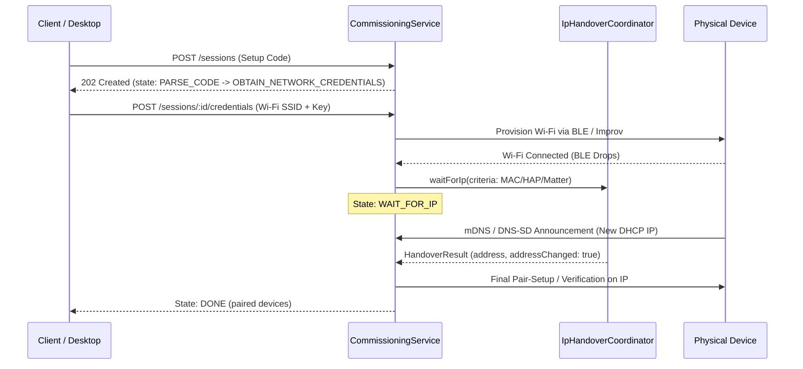

# LAN Discovery, Candidate Matching & IP Handover — P20.3

Documented evidence for P20.3: protocol-specific DNS-SD matchers (HAP-IP, Matter, ESPHome, Shelly, WLED, Tasmota), durable cryptographic/hardware identity extraction, candidate pairing availability enforcement, TTL expiration pruning, BLE-to-IP handover in `WAIT_FOR_IP`, manual IP fallback, and explicit IPv6/multicast network limitations.

## Protocol-Specific DNS-SD Matchers & Identity Extraction

DNS-SD announcements are parsed into strongly-typed structures (`parseDnsSdTxt` in `packages/core/src/commissioning/dns-sd-matchers.ts`):

1. **HAP-IP (`_hap._tcp`):**
   - Extracts pairing availability flag `sf`: `sf === '1'` indicates unpaired accessory ready for commissioning; `sf === '0'` indicates already-paired accessory.
   - Extracts durable cryptographic accessory ID `id` (`hap:<id>`), setup hash `sh`, model `md`, category ID `ci`, state number `s#`, and config number `c#`.
2. **Matter Commissionable (`_matterc._udp`):**
   - Extracts commissioning mode `CM`: `1` (basic commissioning) or `2` (enhanced commissioning) indicate commissionable status; `0` indicates closed commissioning window.
   - Extracts 12-bit long discriminator `D`, derives 4-bit short discriminator `(D >> 8) & 0x0F`, vendor ID and product ID (`VP`), device name `DN`, device type `DT`, and rotating device ID `RI` (`matter-ri:<id>`).
3. **Matter Operational (`_matter._tcp`):**
   - Matches operational nodes on fabric `<compressedFabricId>-<nodeId>`, marking `pairingAvailable: false`.
4. **Vendor Announcements:**
   - **ESPHome (`_esphomelib._tcp`):** Extracts MAC, platform (ESP8266/ESP32/RP2040), board, and version.
   - **Shelly (`_shelly._tcp`):** Extracts device ID, MAC, model, generation (`gen`), and firmware version.
   - **WLED (`_wled._tcp`):** Extracts MAC and brand.
   - **Tasmota (`_tasmota._tcp`):** Extracts MAC and IP.

### Anti-Shortcut Rule: Rejection of Ephemeral Network Sweep as Identity

An IP address, mDNS hostname, or unicast UDP-5353 sweep response is **never** treated as an authenticated identity. `pickPrimaryDurableId` enforces cryptographic and hardware precedence:

1. `matter` (operational node ID / rotating ID)
2. `hap` (cryptographic accessory ID)
3. `mac` (EUI-48 / IEEE 802 hardware address)
4. `uuid` (UUID/URN)
5. `usb` (VID:PID + serial)
6. `net` (ephemeral IP:port fallback, lowest precedence)

Discovered candidates strictly retain the invariant `authenticated: false`.

## Candidate TTL Tracking & Expiration Pruning

Every candidate ingested into `DiscoveryRegistry` tracks `ttlMs` and `expiresAt` (default 120s or derived from DNS-SD record TTL).

- `pruneExpired(now)`: Purges stale, unconfigured candidate entries whose `expiresAt` has elapsed without touching active `in_progress` or `configured` entries.
- `waitForCandidate(predicate, { timeoutMs, signal })`: Asynchronously resolves when an unexpired candidate matching the predicate is ingested, avoiding busy polling loops while supporting timeouts and `AbortSignal` cancellation.

## BLE-to-IP Handover Lifecycle

When a device is provisioned over BLE (e.g. Improv BLE, Matter BLE) or SoftAP, it transitions through:
`NETWORK_PROVISION` -> `WAIT_FOR_IP` -> `FINAL_PAIR` -> `VERIFY` -> `DONE`.

1. **BLE Disconnect Resilience:** Radio disconnect during Wi-Fi reboot is treated as normal handover progression, never an immediate failure.
2. **Dynamic Address Re-binding:** When the device receives a new DHCP IP address on the local network, `IpHandoverCoordinator` updates the target address seamlessly.
3. **Cancellation Safety:** Client cancellation aborts pending handover listeners cleanly without leaks.
4. **Manual IP Fallback:** If mDNS multicast is dropped or filtered by network hardware, the user provides the IP address via `POST /api/commissioning/sessions/:id/manual-address`, immediately satisfying the handover and continuing pairing.

## Network & Protocol Limitations

1. **Link-Local Multicast Scope (RFC 6762 / RFC 6763):**
   - mDNS broadcasts to `224.0.0.251:5353` (IPv4) and `[ff02::fb]:5353` (IPv6 link-local).
   - Link-local packets have TTL 1 and do **not** route across VLANs or subnets without an active mDNS repeater/reflector (e.g., Avahi reflector, IGMP proxy).
2. **Wi-Fi AP Multicast Filtering & IGMP Snooping:**
   - Many consumer Wi-Fi access points and mesh systems drop multicast packets or throttle them to battery-powered clients.
3. **IPv6 Link-Local Addressing:**
   - IPv6 link-local addresses (`fe80::/10`) require an explicit interface zone scope ID (e.g. `%en0` or `%eth0`) and cannot be connected to without interface scoping.
4. **Manual Fallback Necessity:**
   - The manual address endpoint (`POST /sessions/:id/manual-address`) is essential for cross-VLAN topologies, isolated guest networks, and environments with disabled multicast.

## Observed Verification Evidence

- **PASS** — `pnpm --filter @haus/core test test/discovery.test.ts` (14 unit tests passed, 62ms).
- **PASS** — `pnpm --filter @haus/hub test test/standalone/commissioning-handover.test.ts` (1 integration test passed, 524ms).
- **PASS** — `pnpm --filter @haus/hub test test/standalone/` (13 test files, 39 tests passed, 17.82s).
- **PASS** — `pnpm --filter @haus/core typecheck` (0 errors).
- **PASS** — `pnpm --filter @haus/hub typecheck` (0 errors).
