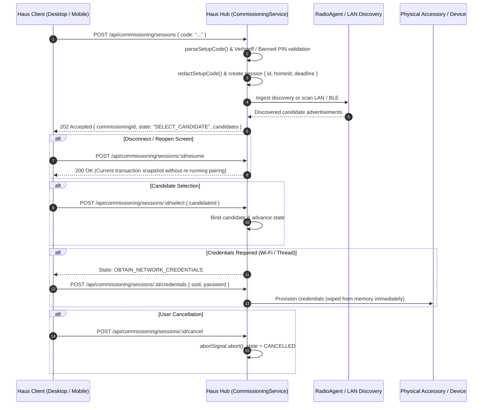

# Resumable Code-First Commissioning Transactions and Protocol Code Parsing (P20.1 & P20.2)

Date: 2026-11-12
Author: Antigravity Assistant
Plan References: `P20.1` (Resumable commissioning transaction) and `P20.2` (Validated setup-code parsing)
Related: `docs/backlog/onboarding.md`

## 1. Context & Architecture

Haus device onboarding follows a strict **code-first** architecture. Rather than forcing users through fragmented vendor-specific wizards or manual protocol selections, onboarding begins with entering or scanning a physical setup code (Matter QR `MT:`, 11/21-digit Matter manual codes, HomeKit `X-HM://` URIs, formatted 8-digit HomeKit PINs, or Improv/vendor identifiers).

To ensure resilient and safe device pairing across varied radio and network transports, transactions must be **resumable**, **idempotent**, **fail-closed**, and **strictly redact secrets**:

1. **Resumable Transactions (`P20.1`):** A client screen dismissal, app reboot, or network reconnection must never restart physical pairing, re-issue BLE commands, or create a split coordinator identity. Sessions expose `/resume`, `/cancel`, `/select`, and incremental event polling via `?sinceSeq=...`.
2. **Authenticated Multi-Home Isolation:** Every transaction is immutably bound to `homeId`, `hubId`, and `userId`. Any cross-home inspection or mutation attempt is rejected fail-closed with 403 Forbidden (`wrong_home`).
3. **Validated Code Parsing & Checksums (`P20.2`):** Manual Matter codes are validated against the full dihedral group $D_5$ Verhoeff checksum algorithm; corrupt check digits are rejected before physical radio transmission. 21-digit manual codes validate check digit 1 at position 10 and unpack 5-digit VID and PID fields. HomeKit PINs reject known banned weak patterns (e.g. `000-00-000`, `111-11-111`, `123-45-678`, `876-54-321`).
4. **Secret Redaction:** Raw setup codes, cleartext PINs, passcodes, and Wi-Fi credentials are stripped in `redactSetupCode()` and never returned in transaction state, event streams, or ordinary UI state.

## 2. Invariants Enforced

- **Idempotency against Duplicate Attempts:** Submitting an identical setup code for the same home while a session is active returns the existing transaction snapshot, preventing concurrent pairing conflicts or duplicate controller sessions.
- **Fail-Closed Home Authorization:** Requests from mismatched `homeId` values are rejected with `403 Forbidden` (`wrong_home`).
- **Deadline Expiration:** If an interactive step (candidate selection or credential entry) exceeds its deadline (`deadlineMs`), the transaction safely transitions to `FAILED` with `deadline_exceeded`.
- **Zero Secret Echo:** Cleartext PINs, setup codes, and network passwords are wiped from transaction snapshots, logs, and event streams.

## 3. Verification Evidence

- `packages/core/test/commissioning.test.ts` (157 lines): 10 test suites covering Verhoeff validation/computation, 11-digit & 21-digit Matter manual codes, corrupt check digit rejection, HomeKit PIN parsing & banned weak PIN rejection, HomeKit URI base36 category/flags extraction, ambiguous bare numeric inputs, vendor prefixes, and secret redaction.
- `apps/hub/test/standalone/commissioning-transaction.test.ts` (243 lines): End-to-end integration test running against standalone Hub instance verifying creation, duplicate attempt reuse, screen reconnection resume, incremental `sinceSeq` event streaming, candidate selection, credential provisioning with memory wipe, user cancellation, wrong-home access isolation, and deadline enforcement.
- Full standalone suite: 12 test files, 38 passed tests (`pnpm --filter @haus/hub test test/standalone/`).
- Workspace typecheck: `pnpm typecheck` (18 packages PASS).
- Workspace lint: `pnpm lint` (`oxlint --deny-warnings` 0 errors, 0 warnings across 1693 files).
- Engineering rules: `pnpm rules:check` PASS (file lengths <= 500 lines, 0 new `any`, <= 25 files/dir, license headers, credential leaks).
- Architecture boundaries: `pnpm architecture:check` PASS (452 source files).
